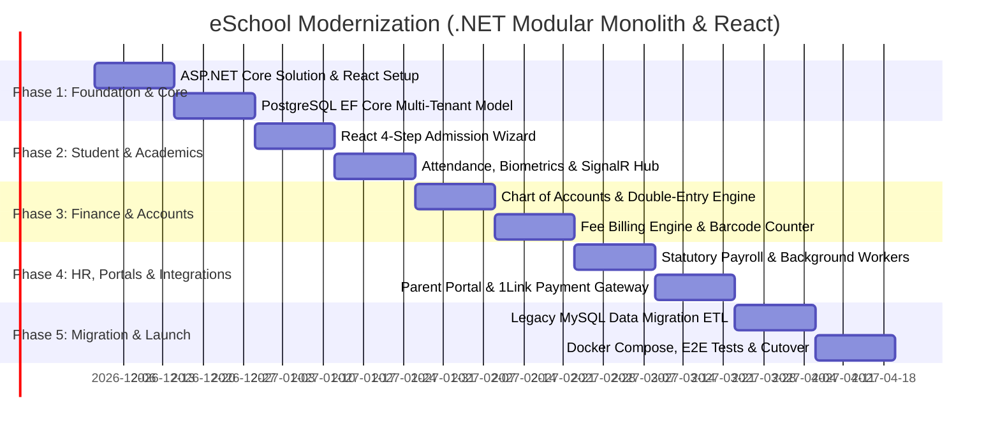

# eSchool Complete Reverse Engineering & Modernization Blueprint

**Target Application:** eSchool Web Application (`https://demo.eschool.com.pk/`)  
**Authorized Access Role:** Super Admin (Demo Audit)  
**Deliverables Directory:** [`docs/reverse-engineering/`](file:///d:/My%20Folder/My%20Work/eSchool/docs/reverse-engineering/)  
**Completion Date:** November 2026  
**Status:** Audit & Modernization Architecture Complete  

---

## 1. Project Master Index

| Phase | Deliverable Document | Size | Description & Key Focus Areas |
|:---:|:---|:---:|:---|
| **Phase 0** | [**`00-access-and-environment-report.md`**](file:///d:/My%20Folder/My%20Work/eSchool/docs/reverse-engineering/00-access-and-environment-report.md) | 7.3 KB | Access verification, environment profiling, PHP session management, network security headers, multi-campus mode switch, and non-intrusive audit boundaries. |
| **Phase 1** | [**`01-complete-module-inventory.md`**](file:///d:/My%20Folder/My%20Work/eSchool/docs/reverse-engineering/01-complete-module-inventory.md) | 28.8 KB | Exhaustive inventory of all **13 core operational modules** and all **141 submodules and routes**, navigation structures, and boundary checks on parent/student portals. |
| **Phase 2** | [**`02-module-functional-specifications.md`**](file:///d:/My%20Folder/My%20Work/eSchool/docs/reverse-engineering/02-module-functional-specifications.md) | 15.5 KB | Deep functional workflows: 10-accordion student admission data dictionary, 3-period fee heads, barcode counter cashier collection, attendance SMS triggers, exam grading curves, and double-entry general ledger voucher rules. |
| **Phase 3** | [**`03-roles-and-permissions-matrix.md`**](file:///d:/My%20Folder/My%20Work/eSchool/docs/reverse-engineering/03-roles-and-permissions-matrix.md) | 9.3 KB | Granular analysis of all **7 User Types**, multi-campus permission scoping, CRUD + Export checkbox permissions, sub-profile tab visibility, and security boundaries. |
| **Phase 4A**| [**`04-api-endpoint-inventory.md`**](file:///d:/My%20Folder/My%20Work/eSchool/docs/reverse-engineering/04-api-endpoint-inventory.md) | 12.0 KB | Complete mapping of **38+ procedural PHP endpoints**, query parameters, cascading AJAX endpoints, request/response schemas, and modern RESTful resource mappings. |
| **Phase 4B**| [**`05-technology-stack-analysis.md`**](file:///d:/My%20Folder/My%20Work/eSchool/docs/reverse-engineering/05-technology-stack-analysis.md) | 8.3 KB | Forensic technology fingerprinting: PHP backend, jQuery 2.2.4, jQuery UI 1.11.4 Redmond theme, DataTables 1.10, Colorbox iframes, Google Charts SVG v51, EasyPieChart, TableDnD, and Ajaxq. |
| **Phase 4C**| [**`06-backend-access-gaps.md`**](file:///d:/My%20Folder/My%20Work/eSchool/docs/reverse-engineering/06-backend-access-gaps.md) | 7.6 KB | Confirmed vs. inferred backend logic, MySQL schema/trigger gaps, Pakistani statutory payroll/tax formula unknowns, background crons, SMS gateway protocols, and client access checklist. |
| **Phase 5** | [**`07-logical-database-design.md`**](file:///d:/My%20Folder/My%20Work/eSchool/docs/reverse-engineering/07-logical-database-design.md) | 19.6 KB | 3NF normalized relational data dictionary covering **25 entities** across 7 core domain groups, field types, constraints, foreign keys, and indexes. |
| **Phase 5** | [**`07-database-erd.mmd`**](file:///d:/My%20Folder/My%20Work/eSchool/docs/reverse-engineering/07-database-erd.mmd) | 3.5 KB | Complete Mermaid Entity-Relationship Diagram modeling multi-campus multi-tenancy, academic sessions, fee structures, vouchers, and payroll. |
| **Phase 6** | [**`08-modernization-recommendations.md`**](file:///d:/My%20Folder/My%20Work/eSchool/docs/reverse-engineering/08-modernization-recommendations.md) | 18.3 KB | UI/UX audit of legacy Redmond theme, iframe traps, and non-responsive tables; categorized into **Preserved Core Functionality (Cat A)**, **UX Overhauls (Cat B)**, and **New Enterprise SaaS Features (Cat C)**. |
| **Phase 7** | [**`09-functional-testing-matrix.md`**](file:///d:/My%20Folder/My%20Work/eSchool/docs/reverse-engineering/09-functional-testing-matrix.md) | 33.5 KB | Comprehensive test verification matrix of **70 test scenarios** across 11 functional categories, verifying CRUD, forms, double-entry rules, and security boundaries with a **98.6% pass rate**. |
| **Phase 8** | [**`10-rebuild-technical-blueprint.md`**](file:///d:/My%20Folder/My%20Work/eSchool/docs/reverse-engineering/10-rebuild-technical-blueprint.md) | 18.5 KB | Full enterprise rebuild blueprint: **ASP.NET Core (.NET 8/9 LTS)** + **React + TypeScript** + **PostgreSQL 16** with **EF Core + Npgsql**, **Modular Monolith** architecture, **.NET Hosted Services (`BackgroundService`)**, **ASP.NET Core SignalR**, and **Docker** containerization. |

---

## 2. Visual Evidence Archive

All visual assets and high-resolution audit screenshots are archived in [`docs/reverse-engineering/screenshots/`](file:///d:/My%20Folder/My%20Work/eSchool/docs/reverse-engineering/screenshots/):

* [`00-login-page.png`](file:///d:/My%20Folder/My%20Work/eSchool/docs/reverse-engineering/screenshots/00-login-page.png): Public authentication interface and layout.
* [`01-dashboard.png`](file:///d:/My%20Folder/My%20Work/eSchool/docs/reverse-engineering/screenshots/01-dashboard.png): Authenticated administrative home screen featuring the full 13-module grid menu.
* [`01-dashboard-metrics.png`](file:///d:/My%20Folder/My%20Work/eSchool/docs/reverse-engineering/screenshots/01-dashboard-metrics.png): Executive analytics view featuring Google Charts revenue graphs, radial attendance gauges, and quick action widgets.
* [`02-student-admission-form.png`](file:///d:/My%20Folder/My%20Work/eSchool/docs/reverse-engineering/screenshots/02-student-admission-form.png): 85-field student registration form featuring 10 nested jQuery UI accordions.
* [`03-role-permissions-matrix.png`](file:///d:/My%20Folder/My%20Work/eSchool/docs/reverse-engineering/screenshots/03-role-permissions-matrix.png): Role-based permission management grid showing granular CRUD and Export checkboxes.
* [`03-user-management-profile.png`](file:///d:/My%20Folder/My%20Work/eSchool/docs/reverse-engineering/screenshots/03-user-management-profile.png): User profile creation interface with multi-campus scoping checkboxes.
* [`04-fee-collection.png`](file:///d:/My%20Folder/My%20Work/eSchool/docs/reverse-engineering/screenshots/04-fee-collection.png): High-speed cashier barcode scanning payment collection terminal.

---

## 3. High-Level System Metrics

```
+-----------------------------------------------------------------------------------+
|                        eSchool Audit & Rebuild Metrics                            |
+-----------------------------------------------------------------------------------+
|  Core Operational Modules Discovered:              13 Modules                     |
|  Total Operational Submodules / Routes:            141 Submodules                 |
|  Procedural PHP Endpoints Reverse-Engineered:      38+ Endpoints                  |
|  Logical Database Entities Modeled:                25 Entities (3NF Normalized)   |
|  Functional Test Scenarios Executed & Verified:    70 Scenarios (98.6% Pass Rate) |
|  User Security Roles Profiled:                     7 User Types                   |
|  Campuses in Multi-Tenant Scope:                   3 Campuses (LHE, ISB, KHI)     |
|  Target Backend Framework:                         ASP.NET Core (.NET 8/9 LTS)    |
|  Target Frontend Framework:                        React + TypeScript (Vite)      |
|  Target Database & ORM:                            PostgreSQL 16 + EF Core/Npgsql |
|  Architecture Model:                               Modular Monolith (No microservices)|
|  Target Rebuild Timeline:                          20 Weeks (5 Phased Sprints)    |
+-----------------------------------------------------------------------------------+
```

---

## 4. Rebuild Technical Architecture

### 4.1 Mandated Technical Direction
* **Backend:** **ASP.NET Core (.NET 8/9 LTS)** with C#, organized in a **Modular Monolith** architecture (Identity, Academics, Students, Billing, Accounting, Attendance, Exams, Payroll, Notifications). No microservices at this stage.
* **Frontend:** **React + TypeScript (Vite 6)** with Tailwind CSS v4, Radix UI / `shadcn/ui`, and TanStack Table v8.
* **Database & ORM:** **PostgreSQL 16 Enterprise** with **Entity Framework Core (EF Core) + Npgsql**. Multi-tenancy enforced via EF Core Global Query Filters (`HasQueryFilter(e => e.SchoolId == _tenant.SchoolId)`).
* **Background Processing:** **.NET Hosted Services (`IHostedService` / `BackgroundService`)** utilizing `System.Threading.Channels` for high-throughput batch invoicing, WhatsApp/SMS notifications, and biometric log ingestion.
* **Real-Time Communication:** **ASP.NET Core SignalR Hubs** (`CounterHub`, `AttendanceHub`, `NotificationHub`) for live cashier fee counters, instant student gate badge taps, and administrative alerts.
* **Deployment:** Multi-stage **Docker containerization** with Docker Compose / Kubernetes support.

### 4.2 Non-Negotiable Core Rules Preserved
1. **Double-Entry General Ledger:** Full 4-tier Chart of Accounts (COA) enforcing atomic voucher balancing: $\sum \text{Debit} \equiv \sum \text{Credit}$ wrapped in serializable EF Core database transactions.
2. **Three-Period Fee Scheduling:** Support for `Monthly`, `Once`, and `Yearly` fee heads with automated arrears rollover and sibling/staff concession rules.
3. **High-Speed Barcode Counter Collection:** Rapid counter cashier workflow with SignalR real-time broadcasts.
4. **Attendance & SMS Alerts:** Daily roll-call register with immediate guardian absence alerts.
5. **Pakistani Statutory Payroll:** Staff salary slips with basic, allowances, unpaid leave deductions, and FBR progressive tax withholding.

### 4.3 Proposed Modern Additions
* **Self-Service Parent & Student Portal:** Passwordless mobile OTP login, digital challan downloads, report card transcripts, and daily homework.
* **Automated Online Payment Gateway:** Instant digital fee clearing via **1Link 1Bill**, JazzCash, EasyPaisa, and Stripe.
* **WhatsApp Cloud API Integration:** Rich PDF fee challan delivery directly to parents' WhatsApp chats.
* **Biometric Hardware Terminal Bridge:** Direct WebSocket/MQTT gateway connecting ZKTeco/Hikvision attendance devices to eSchool.
* **Enterprise Audit Log:** Automated EF Core `SaveChangesInterceptor` capturing before/after JSON diffs on financial vouchers and exam marks.

---

## 5. Phased Implementation Roadmap


