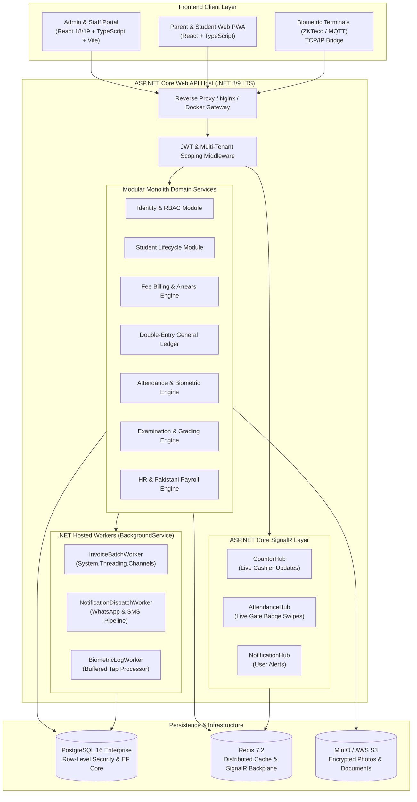
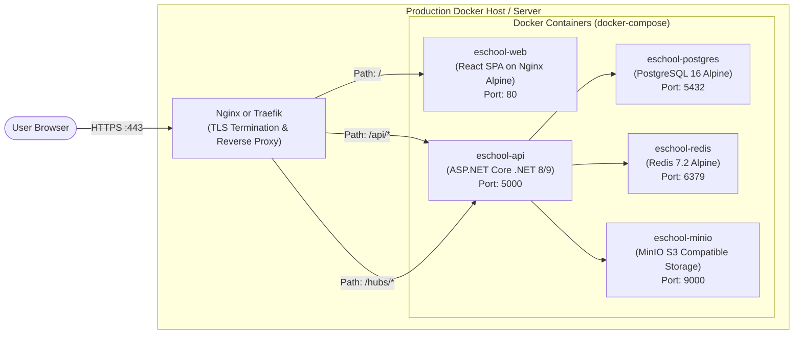

# eSchool Independent Rebuild Technical Blueprint
**Document ID:** `10-rebuild-technical-blueprint.md`  
**Target Project:** eSchool Modernization & Independent Enterprise Rebuild  
**Architecture Paradigm:** Modular Monolith (Clean Architecture)  
**Status:** Comprehensive Architecture & Implementation Specification  
**Author:** Principal Software Architect & Engineering Leadership  

---

## 1. Executive Summary & Architectural Vision

The objective of the eSchool Rebuild Project is to develop a greenfield, enterprise-grade School Management System (SMS) and Enterprise Resource Planning (ERP) platform. The new platform replaces the legacy procedural PHP monolith with a high-performance, maintainable, modular, secure, and accessible **Modular Monolith** architecture.

### Mandated Technical Stack
* **Backend:** **ASP.NET Core (.NET 8/9 LTS)** with C#
* **Frontend:** **React + TypeScript (Vite, Tailwind CSS, shadcn/ui)**
* **Database:** **PostgreSQL 16 Enterprise**
* **ORM:** **Entity Framework Core (EF Core) + Npgsql**
* **Architecture:** **Modular Monolith** (Strictly single deployable unit; no microservices at this stage)
* **Background Processing:** **.NET Hosted Services (`IHostedService` / `BackgroundService`)** with `System.Threading.Channels`
* **Real-Time Communication:** **ASP.NET Core SignalR** for counter updates, biometric attendance sync, and live notifications
* **Deployment:** **Docker-based multi-stage containerization** with Docker Compose / Kubernetes support

---

## 2. Solution Structure & Modular Monolith Design

### 2.1 Architectural Discipline: The Modular Monolith
To prevent the operational overhead, network latency, and distributed transaction complexities of microservices while maintaining high cohesion and loose coupling, the system is designed as a **Modular Monolith**. 

Each business domain exists as an autonomous module within a single solution:
* Modules communicate in-process via strongly typed interfaces, DTOs, or domain events (MediatR / MassTransit in-memory mediator).
* Cross-module direct database queries are prohibited.
* Shared database with EF Core modular DbContexts or bounded context configurations.

```
eSchool.sln
├── src/
│   ├── eSchool.WebAPI/                   # API Host, Middleware, SignalR Hubs, Swagger
│   │   ├── Controllers/
│   │   ├── Hubs/                         # SignalR Hubs (CounterHub, AttendanceHub, NotifyHub)
│   │   ├── Middleware/                   # TenantContextMiddleware, ExceptionMiddleware
│   │   └── Program.cs
│   │
│   ├── eSchool.Client/                   # Frontend SPA (React + TypeScript + Vite)
│   │   ├── src/
│   │   │   ├── components/               # Radix UI / shadcn/ui components
│   │   │   ├── hooks/                    # useSignalR, useAuth, useTenant
│   │   │   ├── modules/                  # Feature slices (Students, Fees, Accounts, etc.)
│   │   │   └── services/                 # Axios / TanStack Query API clients
│   │
│   ├── Modules/
│   │   ├── Identity/                     # Users, Roles, Permissions, JWT Auth, Campus Scopes
│   │   ├── Academics/                    # Sessions, Classes, Sections, Subjects, Timetables
│   │   ├── Students/                     # Admissions, Demographics, Enrollments, Guardians
│   │   ├── Billing/                      # Fee Heads, Invoices, Concessions, Counter Cashier
│   │   ├── Accounting/                   # Chart of Accounts, Vouchers (CPV/CRV/JV), General Ledger
│   │   ├── Attendance/                   # Daily Class Registers, Biometric Sync, SMS Triggers
│   │   ├── Examinations/                 # Terms, Grading Rules, Marks Entry, Tabulation Cards
│   │   ├── Payroll/                      # Employees, Allowances, FBR Tax Deduction, Pay Slips
│   │   └── Notifications/                # SMS Gateways, WhatsApp Cloud API, Email Dispatch
│   │
│   ├── Shared/
│   │   ├── eSchool.SharedKernel/         # BaseEntity, ValueObject, IDomainEvent, Result<T>
│   │   └── eSchool.Infrastructure/       # AppDbContext, EF Core Configurations, Migrations, Interceptors
│   │
│   └── BackgroundWorkers/
│       └── eSchool.Workers/              # .NET BackgroundServices for Batch Jobs & Queues
```

---

## 3. High-Level System Architecture Diagram



---

## 4. Multi-Tenancy & Data Isolation with EF Core + PostgreSQL

### 4.1 Multi-Tenant Context Resolution
Campus multi-tenancy is enforced in ASP.NET Core via custom middleware and Entity Framework Core Global Query Filters:

```csharp
// 1. Tenant Context Service
public interface ITenantContext
{
    Guid CurrentSchoolId { get; }
    IReadOnlyList<Guid> AccessibleSchoolIds { get; }
    void SetTenant(Guid schoolId, IReadOnlyList<Guid> accessibleSchoolIds);
}

// 2. Tenant Context Middleware
public class TenantContextMiddleware
{
    private readonly RequestDelegate _next;

    public TenantContextMiddleware(RequestDelegate next) => _next = next;

    public async Task InvokeAsync(HttpContext context, ITenantContext tenantContext)
    {
        if (context.User.Identity?.IsAuthenticated == true)
        {
            var schoolIdClaim = context.User.FindFirst("SchoolId")?.Value;
            if (Guid.TryParse(schoolIdClaim, out var schoolId))
            {
                var accessible = context.User.FindAll("AccessibleSchools")
                                            .Select(c => Guid.Parse(c.Value))
                                            .ToList();
                tenantContext.SetTenant(schoolId, accessible);
            }
        }
        await _next(context);
    }
}
```

### 4.2 EF Core Global Query Filters & Interceptors
Every tenant-scoped entity implements `IMultiTenantEntity`:
```csharp
public interface IMultiTenantEntity
{
    Guid SchoolId { get; set; }
}
```

In `AppDbContext.OnModelCreating`, EF Core automatically injects a global query filter across all tenant entities:
```csharp
protected override void OnModelCreating(ModelBuilder modelBuilder)
{
    base.OnModelCreating(modelBuilder);

    foreach (var entityType in modelBuilder.Model.GetEntityTypes())
    {
        if (typeof(IMultiTenantEntity).IsAssignableFrom(entityType.ClrType))
        {
            var method = typeof(AppDbContext)
                .GetMethod(nameof(ConfigureGlobalTenantFilter), BindingFlags.NonPublic | BindingFlags.Static)?
                .MakeGenericMethod(entityType.ClrType);
            
            method?.Invoke(null, new object[] { modelBuilder, this });
        }
    }
}

private static void ConfigureGlobalTenantFilter<T>(ModelBuilder builder, AppDbContext context) 
    where T : class, IMultiTenantEntity
{
    builder.Entity<T>().HasQueryFilter(e => e.SchoolId == context._tenantContext.CurrentSchoolId);
}
```

### 4.3 Automated Audit Trail via EF Core Interceptor
To eliminate manual tracking, a custom `SaveChangeInterceptor` captures every entity mutation with JSON before/after snapshots:
```csharp
public class AuditSaveChangesInterceptor : SaveChangesInterceptor
{
    private readonly ITenantContext _tenantContext;
    private readonly ICurrentUser _currentUser;

    public AuditSaveChangesInterceptor(ITenantContext tenantContext, ICurrentUser currentUser)
    {
        _tenantContext = tenantContext;
        _currentUser = currentUser;
    }

    public override async ValueTask<InterceptionResult<int>> SavingChangesAsync(
        DbContextEventData eventData, 
        InterceptionResult<int> result, 
        CancellationToken cancellationToken = default)
    {
        var context = eventData.Context;
        if (context == null) return result;

        var entries = context.ChangeTracker.Entries<BaseEntity>()
            .Where(e => e.State is EntityState.Added or EntityState.Modified or EntityState.Deleted)
            .ToList();

        var auditLogs = new List<AuditLog>();
        foreach (var entry in entries)
        {
            auditLogs.Add(new AuditLog
            {
                Id = Guid.NewGuid(),
                SchoolId = _tenantContext.CurrentSchoolId,
                EntityName = entry.Entity.GetType().Name,
                Action = entry.State.ToString(),
                RecordId = entry.Property("Id").CurrentValue?.ToString() ?? string.Empty,
                OldValues = entry.State is EntityState.Modified or EntityState.Deleted ? JsonSerializer.Serialize(entry.OriginalValues.ToObject()) : null,
                NewValues = entry.State is EntityState.Added or EntityState.Modified ? JsonSerializer.Serialize(entry.CurrentValues.ToObject()) : null,
                UserId = _currentUser.UserId,
                Timestamp = DateTime.UtcNow
            });
        }

        context.Set<AuditLog>().AddRange(auditLogs);
        return result;
    }
}
```

---

## 5. Core Business Engines in ASP.NET Core

### 5.1 The Financial Accounting Engine (General Ledger)
* **Atomic Balancing Enforcement:**
  A voucher cannot be saved if $\sum \text{Debit} \neq \sum \text{Credit}$.
* **Implementation via EF Core Transaction:**
```csharp
public async Task<Result<VoucherDto>> PostVoucherAsync(CreateVoucherCommand cmd, CancellationToken ct)
{
    var totalDebit = cmd.Entries.Sum(e => e.Debit);
    var totalCredit = cmd.Entries.Sum(e => e.Credit);

    if (totalDebit != totalCredit)
        return Result<VoucherDto>.Failure("Voucher out of balance: Total Debit must equal Total Credit.");

    await using var transaction = await _dbContext.Database.BeginTransactionAsync(IsolationLevel.Serializable, ct);
    try
    {
        var voucher = new Voucher
        {
            Id = Guid.NewGuid(),
            SchoolId = _tenantContext.CurrentSchoolId,
            VoucherType = cmd.VoucherType,
            VoucherNumber = await _voucherNumberGenerator.NextAsync(cmd.VoucherType, ct),
            VoucherDate = cmd.VoucherDate,
            TotalAmount = totalDebit,
            IsPosted = true,
            PostedAt = DateTime.UtcNow
        };

        foreach (var item in cmd.Entries)
        {
            voucher.Entries.Add(new VoucherEntry
            {
                Id = Guid.NewGuid(),
                AccountId = item.AccountId,
                Debit = item.Debit,
                Credit = item.Credit,
                Narration = item.Narration
            });
        }

        _dbContext.Vouchers.Add(voucher);
        await _dbContext.SaveChangesAsync(ct);
        await transaction.CommitAsync(ct);

        return Result<VoucherDto>.Success(_mapper.Map<VoucherDto>(voucher));
    }
    catch (Exception ex)
    {
        await transaction.RollbackAsync(ct);
        _logger.LogError(ex, "Failed to post voucher atomically.");
        throw;
    }
}
```

### 5.2 Real-Time Barcode Cashier Collection (with SignalR)
* Cashier scans barcode $\rightarrow$ loads invoice details $\rightarrow$ posts payment.
* Upon payment completion, **`CounterHub`** broadcasts to supervisor consoles and updates school revenue charts in real time:

```csharp
public class CounterHub : Hub
{
    public async Task JoinSchoolCounterGroup(string schoolId)
    {
        await Groups.AddToGroupAsync(Context.ConnectionId, $"Counter_{schoolId}");
    }
}

// In FeePaymentService:
await _hubContext.Clients.Group($"Counter_{schoolId}")
    .SendAsync("OnFeePaymentReceived", new 
    { 
        StudentName = student.FullName, 
        InvoiceNumber = invoice.InvoiceNumber, 
        AmountPaid = payment.AmountPaid,
        Time = DateTime.UtcNow 
    });
```

---

## 6. Asynchronous Background Processing (.NET Hosted Services)

Instead of relying on external job engines or microservices, the system leverages native **.NET 8/9 `BackgroundService`** implementations coupled with thread-safe, high-throughput **`System.Threading.Channels`**:

```
+-----------------------------------------------------------------------------------+
|                  .NET Hosted Background Service Architecture                      |
+-----------------------------------------------------------------------------------+
|  [ API Controller / Service ]                                                     |
|       |                                                                           |
|       v Writes task payload into Channel<T>                                       |
|  [ In-Memory Bounded Channel (System.Threading.Channels) ]                        |
|       |                                                                           |
|       v Reads from ChannelReader<T> asynchronously                                |
|  [ InvoiceBatchBackgroundService : BackgroundService ]                            |
|       | - Creates scoped IServiceScope & AppDbContext                             |
|       | - Generates 5,000 student challans in parallel batches                    |
|       | - Emits progress to client UI via SignalR NotifyHub                       |
+-----------------------------------------------------------------------------------+
```

### 6.1 Channel-Based Invoicing Background Worker
```csharp
public class InvoiceGenerationWorker : BackgroundService
{
    private readonly ChannelReader<GenerateInvoiceJob> _channelReader;
    private readonly IServiceProvider _serviceProvider;
    private readonly ILogger<InvoiceGenerationWorker> _logger;

    public InvoiceGenerationWorker(
        Channel<GenerateInvoiceJob> channel, 
        IServiceProvider serviceProvider, 
        ILogger<InvoiceGenerationWorker> logger)
    {
        _channelReader = channel.Reader;
        _serviceProvider = serviceProvider;
        _logger = logger;
    }

    protected override async Task ExecuteAsync(CancellationToken stoppingToken)
    {
        _logger.LogInformation("Invoice Generation Background Worker started.");

        await foreach (var job in _channelReader.ReadAllAsync(stoppingToken))
        {
            try
            {
                using var scope = _serviceProvider.CreateScope();
                var feeBillingService = scope.ServiceProvider.GetRequiredService<IFeeBillingService>();
                var hubContext = scope.ServiceProvider.GetRequiredService<IHubContext<NotificationHub>>();

                await feeBillingService.ExecuteBatchInvoiceGenerationAsync(job, stoppingToken);

                await hubContext.Clients.User(job.RequestedByUserId)
                    .SendAsync("JobCompleted", new { JobType = "Invoicing", Month = job.BillingMonth }, stoppingToken);
            }
            catch (Exception ex)
            {
                _logger.LogError(ex, "Error processing invoice generation job {JobId}", job.JobId);
            }
        }
    }
}
```

### 6.2 Notification Worker (WhatsApp & SMS Dual Gateway)
* `NotificationDispatchWorker : BackgroundService` processes pending messages from a durable database queue or channel.
* Integrates directly with **Meta WhatsApp Cloud API** (HTTP Client Factory) and local Pakistani SMS Gateway APIs (Jazz / Telenor / Zong) with exponential backoff retries.

---

## 7. Frontend Architecture: React + TypeScript (SPA)

### 7.1 Modern Frontend Stack
* **Build Tool:** **Vite 6** (sub-second HMR, optimized ES modules).
* **Language:** **TypeScript 5.x** with strict type-checking enabled.
* **Component Primitives:** **Radix UI** with **`shadcn/ui`** styling.
* **Styling:** **Tailwind CSS v4** with unified CSS variables and dark mode support.
* **Data Grid:** **TanStack Table v8 (React Table)** with virtualized windowing (`@tanstack/react-virtual`) for seamless rendering of 10,000+ student rows.
* **Server State Management:** **TanStack Query (React Query v5)** for automatic background refetching, query caching, and optimistic updates.
* **Forms & Validation:** **React Hook Form** + **Zod** schema validation.
* **Real-Time Client:** **`@microsoft/signalr`** client for typed SignalR events.

### 7.2 Frontend Directory Structure
```
eSchool.Client/src/
├── api/                  # Axios / Fetch client with JWT interceptors
├── assets/               # SVG icons, school logos, fonts
├── components/
│   ├── ui/               # shadcn/ui components (Button, Dialog, Sheet, Table, Form)
│   ├── forms/            # Reusable form controls with Zod integration
│   ├── layouts/          # DashboardLayout, Sidebar, Navbar, MobileDrawer
│   └── shared/           # CommandPalette (Cmd+K), BarcodeScannerListener, StatCard
├── features/
│   ├── academics/        # Classes, Sections, Subjects, Timetable
│   ├── accounts/         # Chart of Accounts, Vouchers, Ledger Statement
│   ├── attendance/       # Daily Roll-Call Register, Biometric Status
│   ├── exams/            # Exam Terms, Marks Entry Sheet, Report Cards
│   ├── fees/             # Fee Structures, Challan Generator, Counter Collection
│   ├── hr/               # Employee Directory, Monthly Payroll
│   └── students/         # Student List, 4-Step Admission Wizard, Profile View
├── hooks/                # useSignalR, useAuth, useTenantScope
└── types/                # Generated TypeScript DTO contracts from C# models
```

---

## 8. Docker-Based Deployment Architecture



### 8.1 Multi-Stage Dockerfile for ASP.NET Core API
```dockerfile
# Build Stage
FROM mcr.microsoft.com/dotnet/sdk:8.0-alpine AS build
WORKDIR /app

COPY eSchool.sln ./
COPY src/eSchool.WebAPI/*.csproj ./src/eSchool.WebAPI/
COPY src/Modules/*/*.csproj ./src/Modules/
COPY src/Shared/*/*.csproj ./src/Shared/
COPY src/BackgroundWorkers/*/*.csproj ./src/BackgroundWorkers/

RUN dotnet restore

COPY . .
RUN dotnet publish src/eSchool.WebAPI/eSchool.WebAPI.csproj -c Release -o /app/publish /p:UseAppHost=false

# Runtime Stage
FROM mcr.microsoft.com/dotnet/aspnet:8.0-alpine AS runtime
WORKDIR /app
EXPOSE 5000
ENV ASPNETCORE_URLS=http://+:5000

COPY --from=build /app/publish .
ENTRYPOINT ["dotnet", "eSchool.WebAPI.dll"]
```

### 8.2 Production `docker-compose.yml`
```yaml
version: '3.8'

services:
  eschool-postgres:
    image: postgres:16-alpine
    container_name: eschool-postgres
    restart: always
    environment:
      POSTGRES_DB: eschool_db
      POSTGRES_USER: eschool_admin
      POSTGRES_PASSWORD: ${DB_PASSWORD}
    volumes:
      - postgres_data:/var/lib/postgresql/data
    ports:
      - "5432:5432"

  eschool-redis:
    image: redis:7.2-alpine
    container_name: eschool-redis
    restart: always
    volumes:
      - redis_data:/data
    ports:
      - "6379:6379"

  eschool-api:
    build:
      context: .
      dockerfile: src/eSchool.WebAPI/Dockerfile
    container_name: eschool-api
    restart: always
    environment:
      ConnectionStrings__DefaultConnection: "Host=eschool-postgres;Database=eschool_db;Username=eschool_admin;Password=${DB_PASSWORD}"
      ConnectionStrings__Redis: "eschool-redis:6379"
      ASPNETCORE_ENVIRONMENT: "Production"
    depends_on:
      - eschool-postgres
      - eschool-redis
    ports:
      - "5000:5000"

  eschool-web:
    build:
      context: ./src/eSchool.Client
      dockerfile: Dockerfile
    container_name: eschool-web
    restart: always
    ports:
      - "80:80"
    depends_on:
      - eschool-api

volumes:
  postgres_data:
  redis_data:
```

---

## 9. Phased Implementation Roadmap (20 Weeks)

| Phase | Duration | Focus Area | Deliverables & Milestones |
|:---:|:---:|:---|:---|
| **Phase 1** | Weeks 1–4 | **Foundation, Solution Setup & Multi-Tenancy** | • ASP.NET Core solution setup with Modular Monolith structure.<br>• React + Vite + TypeScript + Tailwind CSS / shadcn/ui frontend setup.<br>• PostgreSQL 16 schema creation & EF Core migrations.<br>• TenantContextMiddleware, Global Query Filters & AuditSaveChangesInterceptor.<br>• JWT authentication, refresh tokens, and user role permission engine. |
| **Phase 2** | Weeks 5–8 | **Student Lifecycle, Academics & Attendance** | • 4-step responsive Student Admission wizard in React.<br>• TanStack Table virtualized Student Directory with column filters.<br>• Academic sessions, classes, sections, and subject mapping.<br>• Daily Class Attendance register with instant absence marking.<br>• Biometric device integration service & SignalR AttendanceHub. |
| **Phase 3** | Weeks 9–12 | **General Ledger & Student Billing Hub** | • 4-tier Chart of Accounts tree structure.<br>• Atomic double-entry voucher posting engine (CPV, CRV, BPV, BRV, JV).<br>• 3-period fee heads, concession rules & batch invoice generator.<br>• Barcode laser scanner cashier fee collection screen with SignalR real-time updates.<br>• Trial Balance, General Ledger statements, and Profit & Loss reports. |
| **Phase 4** | Weeks 13–16 | **Examinations, Payroll & Parent Portal** | • Exam term scheduling, marks entry grid, and auto-ranking formulas.<br>• Tabulation sheets and printable formal student report cards.<br>• Employee HR directory & Pakistani statutory payroll deduction engine.<br>• Responsive Parent & Student Self-Service Portal (PWA).<br>• WhatsApp Business API & SMS notification hosted workers. |
| **Phase 5** | Weeks 17–20 | **Migration, Testing, Dockerization & Cutover** | • Legacy MySQL-to-PostgreSQL ETL data migration script.<br>• Financial balance reconciliation (Trial Balance verification).<br>• End-to-end integration tests with Playwright.<br>• Multi-stage Docker containerization and Docker Compose setup.<br>• Production deployment, UAT sign-off, and weekend DNS cutover. |

---

## 10. Architectural Verification & Compliance Checklist

* [x] **Backend:** ASP.NET Core (.NET 8/9 LTS) with C#.
* [x] **Frontend:** React + TypeScript (Vite + Tailwind CSS + shadcn/ui).
* [x] **Database:** PostgreSQL 16 Enterprise.
* [x] **ORM:** Entity Framework Core (EF Core) + Npgsql.
* [x] **Architecture:** Modular Monolith (Strictly single solution; no microservices).
* [x] **Background Processing:** .NET Hosted Services (`BackgroundService` / `IHostedService`) using `System.Threading.Channels`.
* [x] **Real-Time Communication:** ASP.NET Core SignalR (`CounterHub`, `AttendanceHub`, `NotificationHub`).
* [x] **Deployment:** Docker multi-stage containerization with Docker Compose.
* [x] **Preserved Business Rules:** Double-entry GL, 3-period fee heads, barcode scanning, attendance alerts, Pakistani payroll.
